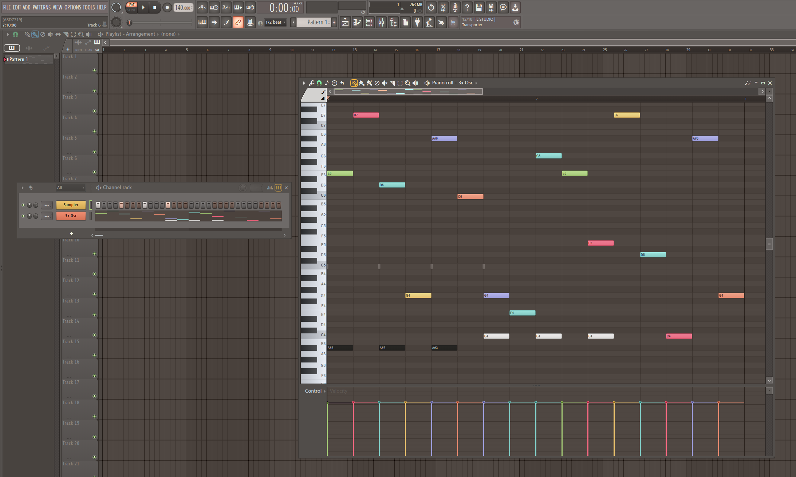

# FL Monokai
### FL Studio theme inspired by [Monokai Pro - Ristretto](https://www.vscolors.com/themes/f5d7ffda-c1d6-4070-ba80-803c705a1ee6-e52aaad0)

It looks like this⬆️
#### How to install
- Put `Monokai.flstheme` in `C:\Program Files\Image-Line\FL Studio 2026\Artwork\Themes`
- Put `Monokai.ncp` in `C:\Program Files\Image-Line\FL Studio 2026\System\Config\Note color presets`
#### How to enable
- Go to `Options > Theme Settings` and select **Monokai**
- Open the Piano Roll and click the arrow at the top left (next to the wrench icon). Click `View > Note Colors` and under `Presets` select **Monokai (factory)**
